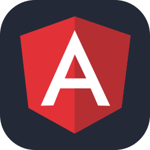

  <h2>Hi, I'm Michael 👋</h2>
  
<b>Software developer and co-founder of <a href="https://neuko-know-how.com">NeuKo know-how</a></b> 
  Varde, Denmark 🇩🇰 · from Germany 🇩🇪

---

### 🧭 What I do

Together with Nelina I run **NeuKo know-how**, a small company on the Danish west coast.
We build **websites and software your customers use to enquire and book – in Danish, German and English.**

- 🌐 **Websites that bring enquiries** – not just visitors
- 🛒 **Online booking and web shops**
- ⚙️ **Processes that run by themselves** – automation, including AI where it saves real work
- 🤝 **Customer relations and portals** – CRM and a customer portal for documents, decisions and approvals

Our focus is the German–Danish bridge: businesses with many German guests or customers,
currently mostly in tourism around Blåvand, Vejers and Henne.

I'm the developer in the team – from analysis and architecture to deployment and running the systems.

---

### 🛠️ What I work with

  
  
  
  
  
  
  
  
  

Self-hosted on our own servers in the EU: Nextcloud, OpenProject, Grafana and Prometheus for monitoring.

---

### 📫 Get in touch

Have a project in mind? Book a free consultation (45 minutes):

- 🌍 [neuko-know-how.com](https://neuko-know-how.com)
- ✉️ m.koch@neuko-know-how.com

Most of our work is for clients and lives in private repositories.
